<!-- README language switch -->
[](README.md) [](README.en.md)

**v1.0.5**: The original-outfit expression preset is gone. Selena always starts from the bridal set; the original stickers stay in the library, and you can pick one for any single interaction.

**v1.0.4**: You choose how long "remind me later" on the rest reminder waits (1–240 minutes, 30 by default). The button on the reminder card shows your choice.

**v1.0.3**: 33 voice lines that were cut short when the assets were exported are complete again. Installed pets swap in the full lines after updating, and the end of a line is no longer clipped.

**v1.0.2 / v1.0.1**: Once a line starts, she finishes it. Clicking or dragging her while she talks changes her expression without cutting her off. The settings window opens with every preview in view.

<!-- /README language switch -->

<div align="center">

# Selena Codex Desktop Pet

**Selena from *Punishing: Gray Raven* keeps you company in Codex. Her expressions follow your tasks, and she answers in her own voice.**

[Download for Windows](https://github.com/Doya16/selena-codex-pet/releases/latest) · [User guide (Chinese)](docs/USAGE.md) · [Report an issue](https://github.com/Doya16/selena-codex-pet/issues) · [中文](README.md)
<!-- DEMO-LINKS: when the video is final, add [Watch the demo](<release asset mp4 link>) after "Download for Windows"; add the Bilibili link if it is published there. -->


[Landscape cover](docs/social/cover-landscape.jpg) · [4:3 cover](docs/social/cover-4x3.jpg)

</div>

Selena keeps you company in **Codex**. Her expression changes while a task runs. When it finishes, she answers with a voice line and a subtitle bubble, and floating text shows how long the turn took. The bar under her shows how much of your Codex plan is left, or your overage credits.

For **Windows 10/11 x64**. The full package includes **the bridal expression preset, a library of 128 stickers, and 115 Selena voice lines with subtitles**, plus two fonts. Expressions, playback timing, bubbles, voices and appearance are preset: extract the package, double-click the one-click setup script and you're done. No Python needed. There is also a [DeepSeek edition](https://github.com/Doya16/selena-deepseek-pet); both can run at the same time with separate settings.

## Installation

**Requirements**: Windows 10 (1809 or later) or Windows 11, 64-bit; Windows 7 / 8 are not supported. Install and sign in to **Codex** on Windows first (the pet also runs without it; connect later).

1. Open [Releases](https://github.com/Doya16/selena-codex-pet/releases/latest) and download **Selena-Codex-Windows-v1.0.5.zip**.
2. Extract it: right-click the ZIP → **Extract All**, or in 7-Zip / WinRAR choose **Extract to "Selena-Codex-Windows-v…\"** (a folder named after the ZIP).
   - Don't choose "Extract here": the ZIP has no top-level folder, so the files would spill into your Downloads folder.
   - Don't extract into a folder you cannot write to, such as `C:\Program Files`, and don't run it from inside the archive viewer.
3. Open the extracted folder and double-click **一键部署.cmd** (one-click deploy). It:
   - checks that the package is complete and the folder is writable;
   - checks for Codex (the pet still runs without it);
   - creates desktop and Start menu shortcuts;
   - starts Selena.
4. Right-click the pet → **Settings**: choose the conversation to follow in **Connect Codex**, and change expressions and voices in the **Interaction Studio**.

Afterwards, start the pet from the desktop shortcut. You can also skip the script and run **赛琳娜Codex桌宠启动.exe** directly; the first launch creates a desktop shortcut too. Keep the other folders next to it.

**If Windows or your security software stops it:**

- If **Windows protected your PC** appears, click **More info** → **Run anyway**; if **Open File - Security Warning** appears, click **Run**. The program has no paid code-signing certificate, which is why Windows asks; it is not a virus.
- If 360, Huorong or another security suite blocks it, add the folder to its trusted list. All source code is public on GitHub: [github.com/Doya16/selena-codex-pet](https://github.com/Doya16/selena-codex-pet). Every release page has a SHA256SUMS file for checking that your download is complete and unmodified.

When a new version is out, the pet tells you; click **更新并重启赛琳娜** (update and restart Selena) to update in one step, keeping your settings and assets (see "One-click updates" below).

Sound is on by default at 10% volume. Change it in Settings → Desktop & Sound.

## Preview

<!-- DEMO-PREVIEW: when the video is final, put here


[Landscape · 1920×1080](<release asset mp4 link>)

The demo shows **v1.0.5** and runs **mm:ss**. The client window and tasks are examples; the pet and settings are the real interface.

| Time | What it shows |
| --- | --- |
| 00:00 | (fill in from the final cut's chapters) |
-->

These are the real program's windows; the plan figure is an example.

| Top lock: click-through when locked | Plan usage under the pet |
| --- | --- |
| 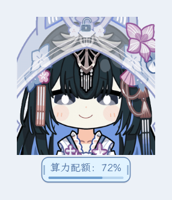 |  |

| Task done: the time floats up | Water and stretch reminder |
| --- | --- |
|  | 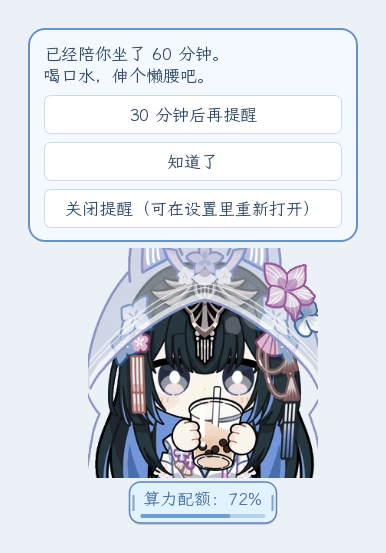 |

## Expressions

The default is the **bridal outfit (Pianissimo)** sticker set, with a matching expression for each of the 16 interactions:

| Mouse | Task states | Other |
| --- | --- | --- |
| pat (click), double-click, hover, drag, drop, milk tea | thinking, reading, editing, running tools, waiting for you, done, error, paused | idle, status not updated |

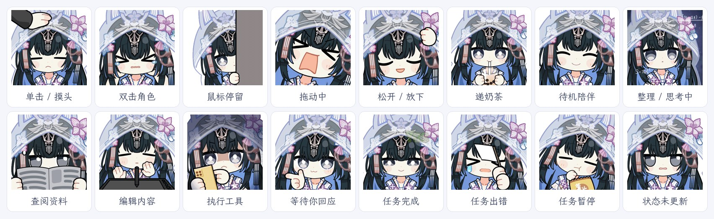

The library also has the original-outfit, community, Christmas and New Year sets: **128 stickers** in all, bridal included. In **Settings → Interaction Studio** you can give any interaction any of them, or import your own images.

Each expression lasts until its voice line ends: a play-once GIF holds its last frame, and a looping one keeps looping.

## Voice and subtitles

- **115 Selena voice lines** from the Tempest, Capriccio and Pianissimo frame voices and event-story voice acting, matched to the 16 interactions, each with a subtitle. When an action has several lines, one is picked at random.
- **Lines play in full**: click, double-click, drag or hand her milk tea while she is talking and her expression changes, but no new line starts. When the action ends, the talking expression comes back until the line is done.
- **Subtitle bubbles** show the line above her. The default font is ZCOOL KuaiLe. Set the size and width in **Settings → Font & Size**, or drag the bubble's left or right edge.
- **How often she talks**: by default, entering idle has a 20% chance of a line, at least 300 seconds apart. Thinking can be set to speak once per task.
- **Quiet companion (mute)**: tick it in the right-click menu to stop the sound at once. Untick to get your old volume back.
- Each line's start and end is logged in `voice-log.txt` in the program folder; attach it if you report a line that didn't finish.

## Following your tasks

- While a task runs, her expression moves through thinking, reading, editing, running tools and waiting for you. At the end she shows done, error or paused.
- When several projects run at once and finish one after another, their notices queue up, and each line finishes before the next starts.
- In **Settings → Connect Codex → Conversation to follow**, choose "Follow the most recent activity" (recommended) or pin one conversation.
- Tick "Show published task progress in the bubble" to see progress text in the bubble while a task runs.

## Plan usage

The bar under her switches with your account data:

| Shows | Meaning |
| --- | --- |
| 算力配额：72% | Share of the plan window still available; with several windows, the lower one |
| 超限配额：1,234.56 | After the plan runs out, the credits balance your account reports |
| 已达支出上限 | Your account reports a spending limit |

Hover to see each usage window and when it resets; right-click → **刷新额度** (refresh usage) to read it again now. A `*` after the number means a cached reading. The percentage is `100% − used percentage`, not money or a fixed number of requests; see the [user guide (Chinese)](docs/USAGE.md).

## Desktop companion

- **Completion float and confetti**: when a task finishes, the time the turn took floats up beside her and confetti bursts. Style, position and confetti can be changed or turned off in **Settings → Desktop & Sound**.
- **Edge docking**: drop her at the left or right edge of the screen. She waits there, then tucks half out of sight after a quiet spell (60 seconds by default, 10–600 adjustable). She comes back out for tasks, reminders, when the pointer reaches her, or when you return after 5+ minutes away.
- **Hide in full screen**: tick "Hide while a full-screen program runs" and she hides during full-screen videos and games, then comes back (off by default).
- **Daily recap**: the first launch each day shows a recap of your last day of use: turns finished, errors and the longest turn. Right-click → 今日小结 (today's recap) shows today's at any time.
- **Water and stretch reminder**: after the set time at the computer (60 minutes by default, 15–240), Selena hands you a cup of milk tea and a reminder card appears for 10 seconds. Choose "remind me in N minutes", "got it" or "turn reminders off". Set N in **Settings → Desktop & Sound → Rest reminder → Remind me later**: 1–240 minutes, 30 by default. Being away for 5+ minutes restarts the count.

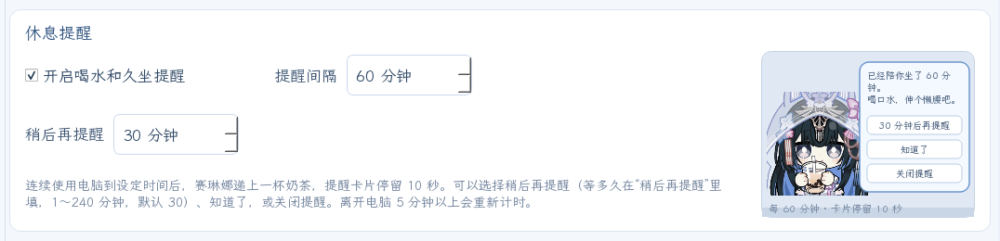

## Settings, mute and lock

Right-click the pet or the tray icon → **Settings…**. One window holds **Font & Size, Interaction Studio, Desktop & Sound, Save & Migrate, Connect Codex, Version & Updates**. On Font & Size and Desktop & Sound, each section has a looping preview card on its right that acts out your current settings without touching the real pet.

- **Top lock**: move the pointer over her and a small lock appears at the top centre; click it to lock or unlock. Locked, clicks pass through her to the window below, and she turns semi-transparent while the pointer is over her (the transparency is adjustable). The lock still responds, and task animations and reminders carry on.
- **Always on top** and **size** (Ctrl + mouse wheel) are set here too.
- **Start and quit with Codex**: tick 随 Codex 启动桌宠 (start with Codex) and 随 Codex 完全退出而关闭 (close when Codex fully quits) in **Settings → Connect Codex**. She closes about 8–10 seconds after Codex fully quits.
- **Sound and tray**: the Windows volume mixer lists her as "赛琳娜 · Codex", so she has her own volume. The tray tooltip reads "赛琳娜 · Codex · 点击唤醒/隐藏" (click to show/hide). The tray and bar icon can be the "app badge" style (the black-and-white GPT badge, the default) or the plain style.
- To close the program: right-click → **关闭赛琳娜** (close Selena).

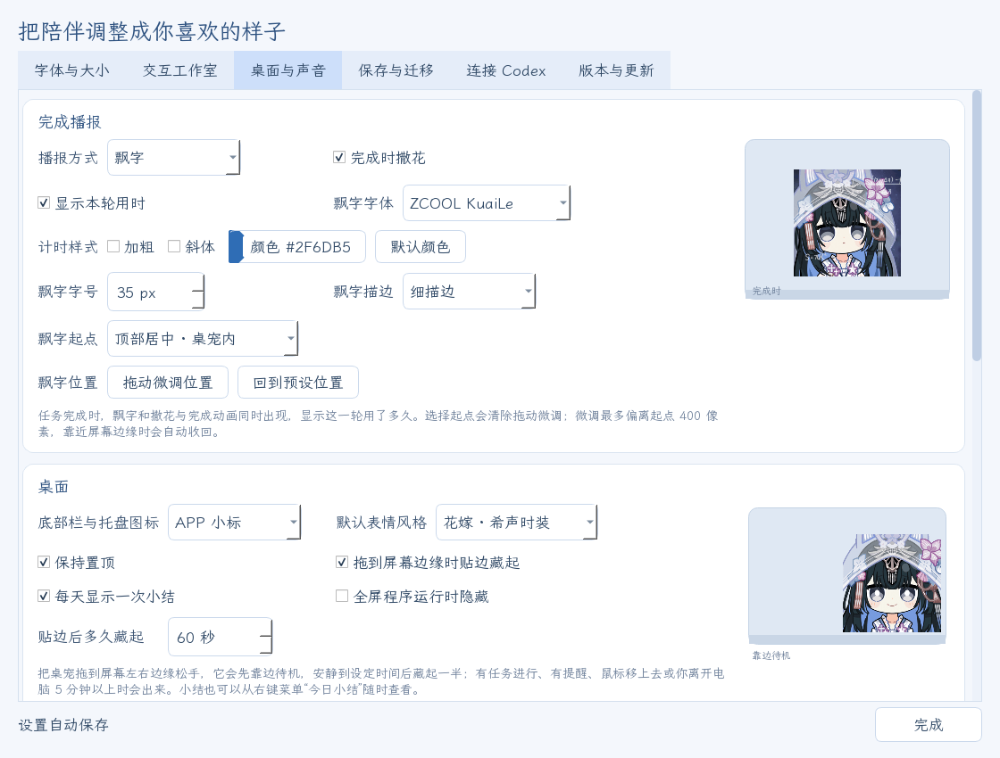

## Customization

Right-click the pet → **Settings → Interaction Studio**. Pick an action on the left, then choose its sticker, playback, bubble and voice.

| What to change | Where |
| --- | --- |
| The sticker for an action | Interaction Studio → action on the left → GIF assets → click a thumbnail |
| Add your own images | GIF assets → Import images; or open the asset folder, drop files in, then refresh |
| Loop, speed, hold and next state | Interaction Studio → Playback & switching |
| Several voice lines per action, each with its own subtitle | Interaction Studio → Voice & paired bubbles |
| Bubble shows only the subtitle of the line playing | Bubble & font → Bubble content → Custom audio + subtitles |
| How often idle lines play | Idle → Automatic line frequency |
| Thinking speaks once per task | Thinking → Play once per task |
| Fonts, font sizes, bubble width, usage bar size | Settings → Font & Size; or drag the bubble or usage bar edges |
| Completion float, confetti, docking, full-screen hiding, rest reminder, lock | Settings → Desktop & Sound |
| Which conversation to follow; start and quit with Codex | Settings → Connect Codex |

| Choose stickers | Voice lines with paired subtitles |
| --- | --- |
| 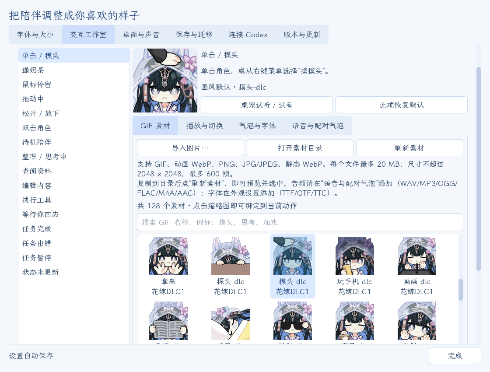 | 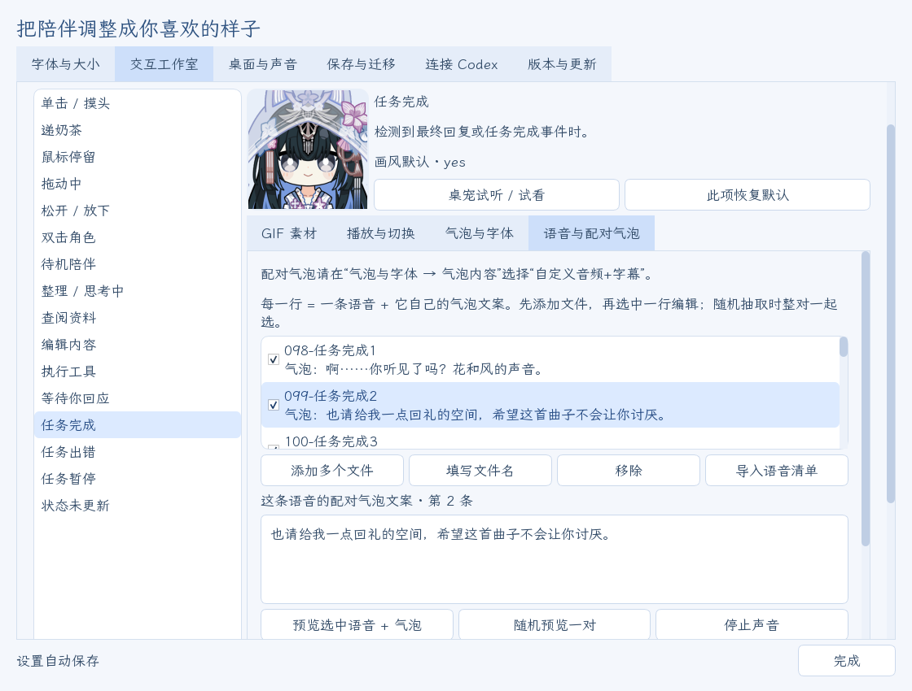 |

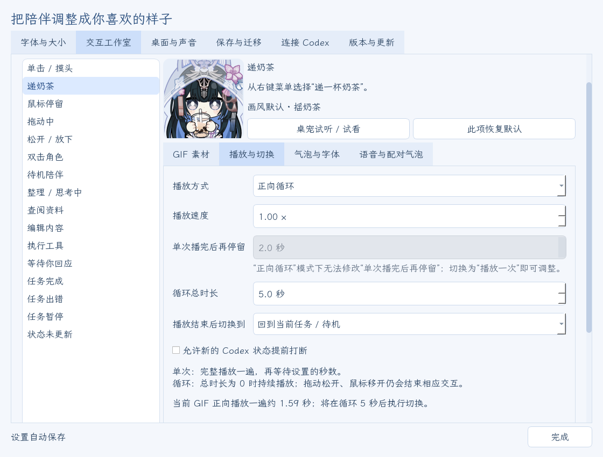

Supported: GIF, animated WebP, PNG, JPG/JPEG; audio in WAV, MP3, OGG, FLAC, M4A, AAC; fonts in TTF, OTF, TTC. Two fonts are included: **LXGW WenKai** and **ZCOOL KuaiLe**.

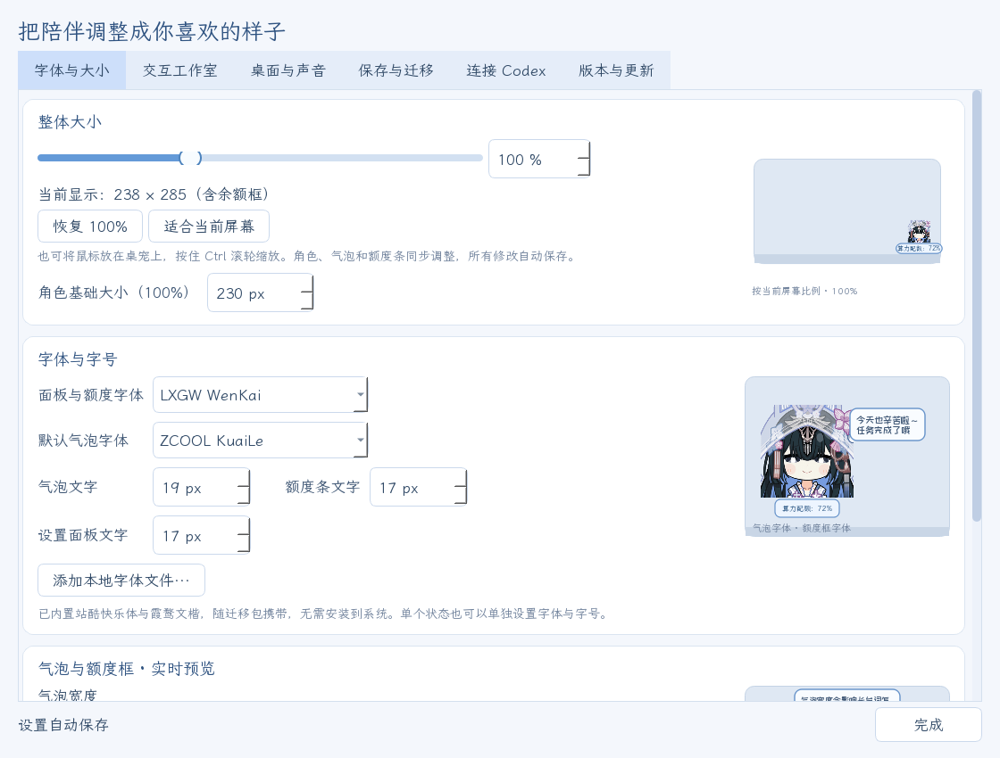

## One-click updates

After launch the pet checks for new versions in the background, every 6 hours by default (1–168 adjustable). When there is one, a silent update bubble appears beside her. Click **更新并重启赛琳娜** (update and restart Selena) to download, verify, install and restart.

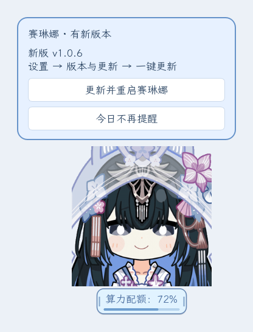

- Updates download only program files and keep your GIFs, voices, subtitles, fonts and all settings.
- The update manifest is signed with the publisher's offline key (Ed25519), and nothing installs if the signature is wrong. This is checked whether the download comes from GitHub or a mirror.
- An interrupted download leaves the current program untouched. If installing is interrupted or the new version fails to start, the previous version and settings are restored.
- **Update source**: **Automatic / GitHub / Mirror (mainland China networks)**. The mirror is the third-party [GH-Proxy](https://gh-proxy.com/docs/github-accelerator), which only carries the files.

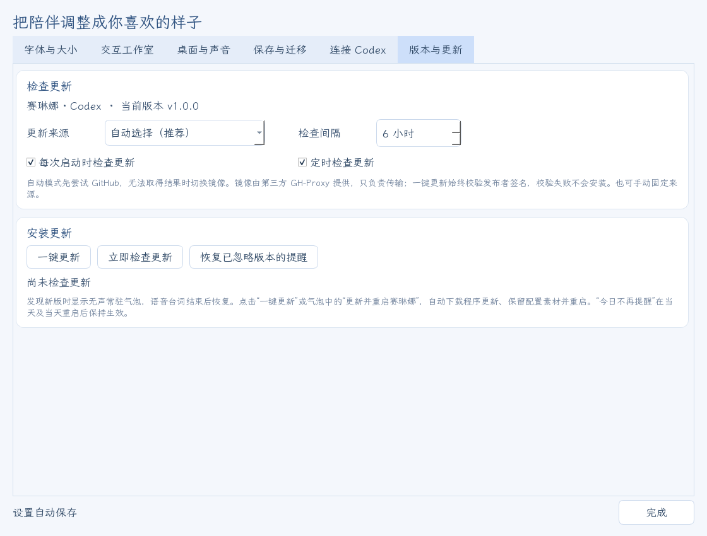

See [Updates and recovery (Chinese)](docs/UPDATES.md).

## Saving and moving to another computer

Settings save automatically. In **Settings → Save & Migrate** you can:

- export a **settings and media pack** (ZIP): GIFs, images, every voice line, paired subtitles, fonts and settings;
- export a **portable Windows package**: all of that plus the program, ready to unzip on a new computer;
- import a pack from someone else, or from the DeepSeek edition, to keep your own setup.

On a new computer, sign in to Codex and start the pet once. Your Codex sign-in and chat history are never in the pet's packs.

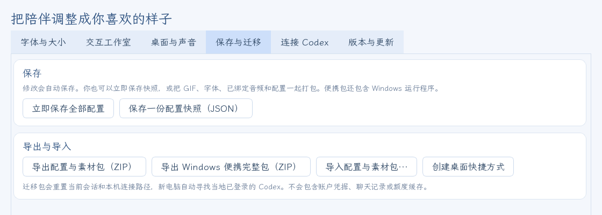

## FAQ

**Setup says it is running from inside the zip?** Extract the whole zip to a folder first, then double-click 一键部署.cmd inside it.

**It says the folder isn't writable?** Don't put it in a system folder such as `C:\Program Files`; use your own folder, for example `D:\赛琳娜Codex桌宠`.

**Her expression doesn't follow a new task?** In "Settings → Connect Codex" choose "Follow the most recent activity".

**She didn't start with Codex?** Run the pet once by hand and check that 随 Codex 启动桌宠 (start with Codex) is ticked. After moving the program folder, run it once from the new folder.

**A line seems cut off?** Attach `voice-log.txt` from the program folder when you report it in [Issues](https://github.com/Doya16/selena-codex-pet/issues).

**Something else?** Open an [issue](https://github.com/Doya16/selena-codex-pet/issues) with your Windows version, the steps and a screenshot of the error.

## Credits

Stickers: shared by the **Selena fan QQ group 978621218** (赛琳娜厨子). Thanks to everyone there who made and shared them (original outfit, bridal, DLC, community, Christmas and New Year sets).

Voice lines: Selena (Tempest, Capriccio, Pianissimo) frame voices and event-story voice acting from *Punishing: Gray Raven*.

Character art, stickers and original voices belong to their respective rights holders (*Punishing: Gray Raven* © KURO GAMES). This is a fan project and is not affiliated with the official game. The stickers are for personal, non-commercial use only; please don't resell them or distribute them for a fee. The licenses of the program's dependencies and fonts don't apply to the character assets; see [asset credits](assets/CREDITS.txt) and [third-party licenses](THIRD_PARTY.txt).

<details>
<summary>Run from source</summary>

Install Python 3.12, then in the project folder:

```powershell
python -m venv .venv
.\.venv\Scripts\python.exe -m pip install -r requirements.txt
.\.venv\Scripts\python.exe -m selena_pet
```

Source entry point: **赛琳娜Codex桌宠启动.vbs** in the root, or the commands above. The program is in `selena_pet/`, and build, release and shortcut tools in `tools/`.

Portable build: run `.\.venv\Scripts\python.exe -m pip install -r tools/requirements-build.txt`, then `.\.venv\Scripts\python.exe tools/build_portable.py`. The output is in `dist/赛琳娜Codex桌宠/`. Release files come from `tools/make_release.py`; the update manifest is signed with `tools/sign_update.py --key`.

Tests: `.\.venv\Scripts\python.exe -m unittest discover -s tests`.

</details>
