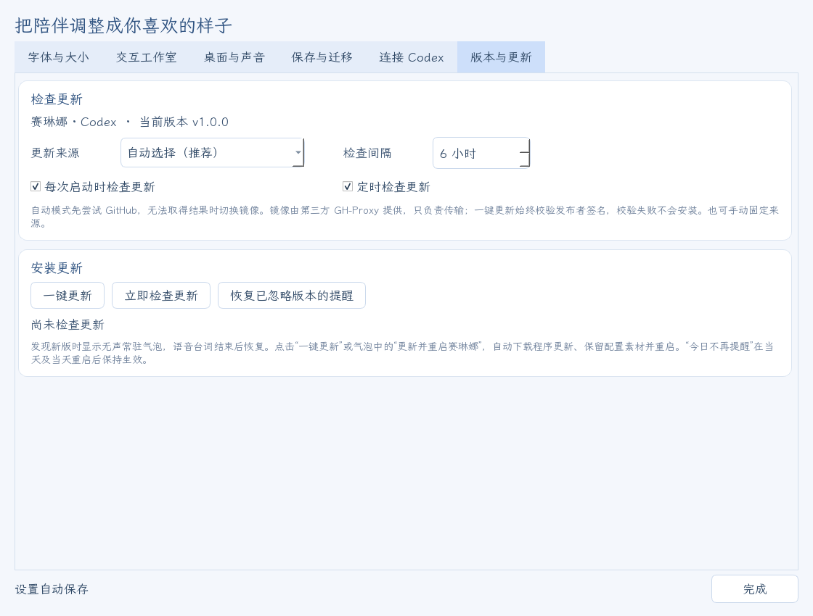
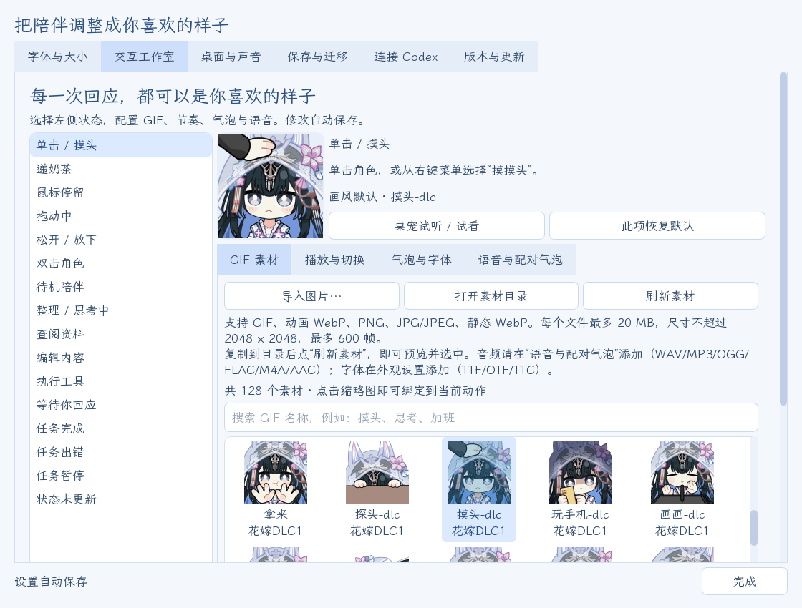
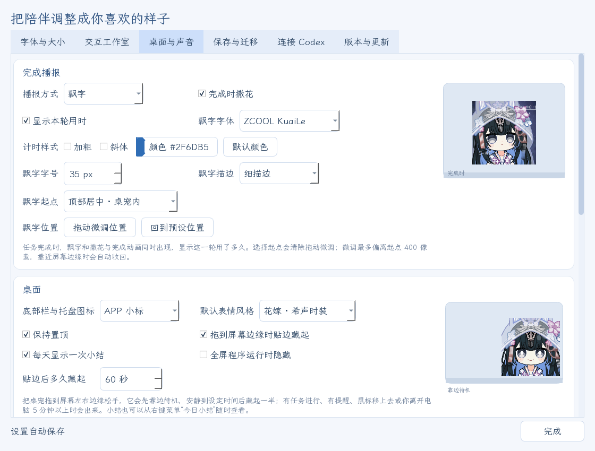

<!-- README language switch -->
[](README.md) [](README.en.md)

**v1.0.3**：补全了 33 条在素材导出时被截短的语音，已安装的桌宠更新后会自动换上完整版本，每句台词的结尾也不再被吞掉一小段。台词一旦开始就会完整说完，说话时点她、拖动她只换动作、不再打断；设置窗口打开即可看到全部预览。两套皮肤（花嫁 / 原皮）共 128 个表情，115 条赛琳娜语音按 16 种交互配好；完整包附带「一键部署」，之后在桌宠内一键更新。

<!-- /README language switch -->

<div align="center">

# 赛琳娜 Codex 桌宠

**《战双帕弥什》赛琳娜陪你使用 Codex：跟随任务切换表情，用她的声音回应你。**

[下载 Windows 版](https://github.com/Doya16/selena-codex-pet/releases/latest) · [使用指南](docs/USAGE.md) · [问题反馈](https://github.com/Doya16/selena-codex-pet/issues)


</div>

适用于 **Windows 10/11 x64**。完整包附带两套皮肤共 128 个 GIF、115 条赛琳娜语音（含字幕）和字体。表情绑定、播放节奏、气泡、语音及外观都已预设，解压后双击「一键部署」即可使用，无需安装 Python。

## 下载与一键部署

1. 在 Windows 上安装并登录 **Codex**。
2. 打开 [Releases](https://github.com/Doya16/selena-codex-pet/releases/latest)，下载 **Selena-Codex-Windows-v1.0.3.zip**。
3. 把整个 ZIP **完整解压**到一个可写的文件夹，例如 `D:\赛琳娜Codex桌宠`。
4. 双击文件夹里的 **一键部署.cmd**。它会：
   - 检查文件是否解压完整、文件夹能否写入；
   - 检查是否已安装 Codex（没装也能先运行）；
   - 创建桌面和开始菜单快捷方式；
   - 启动赛琳娜。
5. 右键桌宠 → **设置**：在 **连接 Codex** 中选择跟随的会话，在 **交互工作室** 中更换表情和语音。

之后从桌面快捷方式启动即可。也可以不运行一键部署，直接双击 **赛琳娜Codex桌宠启动.exe**，首次启动同样会创建桌面快捷方式。请保留同目录的其他文件夹。

声音默认开启，音量为 10%。在「设置 → 桌面与声音」中调整或关闭。

## 两套皮肤

在 **设置 → 桌面与声音 → 默认表情风格** 中切换，立即生效：

- **花嫁 · 希声时装**（默认）：16 种交互都有对应的花嫁表情。
- **原皮 · 原版**：原版表情包；没有同名动作的交互，用意思最接近的一张代替。


每个交互也可以单独改成任意一张 GIF，两套皮肤的 128 张都能选。

## 一键更新

桌宠启动后会在后台检查新版本，默认每 6 小时检查一次。发现新版时，桌宠旁出现无声更新气泡；点击 **更新并重启赛琳娜**，即可完成下载、校验、安装和重启。

- 更新只下载程序文件，保留 GIF、语音、字幕、字体和全部个人设置。
- 更新清单由发布者离线密钥签名（Ed25519），签名不对就不会安装；无论经 GitHub 还是镜像下载都会校验。
- 下载中断不会修改现有程序；安装中断或新版启动失败，会恢复更新前的版本和设置。
- **更新来源**可选 **自动选择 / GitHub 官方源 / 镜像加速（中国大陆网络）**。镜像由第三方 [GH-Proxy](https://gh-proxy.com/docs/github-accelerator) 提供，只负责传输。



详见 [更新与恢复](docs/UPDATES.md)。

## 功能

- **跟随任务**：思考、查阅、编辑、等待和完成时，切换到对应的表情。多个项目同时运行时，各会话的完成提醒依次播放。
- **鼠标互动**：单击摸头、双击、悬停、拖动、放下、递奶茶，各有回应和语音。
- **赛琳娜的声音**：115 条语音来自岚音、幻奏、希声的机体语音和活动剧情配音，每条都配好字幕；同一动作多条语音随机抽取。
- **自选素材**：每种交互单独选择 GIF 或图片；循环、速度、停留时间和下一状态均可调整；也可以导入自己的图片和语音。
- **陪伴**：完成时飘字显示用时并撒花、贴边藏起、全屏隐藏、每日小结、喝水久坐提醒。
- **外观与额度**：实时缩放，调整字体和字号，桌宠下方显示 Codex 套餐剩余比例或超限配额。
- **保存与迁移**：GIF、声音、气泡、字体和全部配置一起打包，带到另一台电脑。



**声音与托盘**：Windows 音量合成器显示「赛琳娜 · Codex」，可单独调节音量。托盘提示为「赛琳娜 · Codex · 点击唤醒/隐藏」，单击即可切换显示。



## 设置、静音与锁定

右键桌宠或托盘 → **设置…**，在同一个窗口调整 **字体与大小、交互工作室、桌面与声音、保存与迁移、连接 Codex、版本与更新**。

- **安静陪伴（静音）**：立即停止当前和待播声音；取消后恢复原音量。
- **顶部小锁**：鼠标移到角色身上时顶部出现小锁，点击锁定后可点击穿透到下方窗口，悬停时自动淡化。
- **随 Codex 启动 / 退出**：在 **设置 → 连接 Codex** 中勾选。
- 关闭程序：右键 → **关闭赛琳娜**。

## 常见问题

**一键部署提示“在压缩包里直接运行”？** 先把整个 ZIP 解压到一个文件夹，再双击里面的「一键部署.cmd」。

**提示文件夹不能写入？** 不要放在 `C:\Program Files` 这类系统目录，换到自己的文件夹，例如 `D:\赛琳娜Codex桌宠`。

**表情没有跟随新任务？** 在「设置 → 连接 Codex」选择「自动跟随最近活动」。

**没有随 Codex 启动？** 先手动运行一次桌宠，并确认已勾选「随 Codex 启动桌宠」。移动程序目录后，也需要在新目录手动运行一次。

**遇到其他问题？** 到 [Issues](https://github.com/Doya16/selena-codex-pet/issues) 附上系统版本、操作步骤和报错截图。

## 素材来源与致谢

表情包素材来源：**赛琳娜厨子 QQ 群 978621218**。感谢赛琳娜厨子们制作并分享这些表情包（原皮、花嫁、DLC、社区包、圣诞与新年系列）。

角色语音来自《战双帕弥什》赛琳娜（岚音、幻奏、希声）的机体语音与活动剧情配音。

角色、表情包图片与原版语音的权利归各自权利人所有（《战双帕弥什》© 库洛游戏）。本项目为同人作品，与官方无关。表情包仅供个人、非商业使用，请勿倒卖或用于付费分发。程序依赖及字体的许可不适用于角色素材；详见 [素材说明](assets/CREDITS.txt) 和 [第三方许可](THIRD_PARTY.txt)。

<details>
<summary>从源码运行</summary>

安装 Python 3.12，在项目目录执行：

```powershell
python -m venv .venv
.\.venv\Scripts\python.exe -m pip install -r requirements.txt
.\.venv\Scripts\python.exe -m selena_pet
```

源码入口：根目录的 **赛琳娜Codex桌宠启动.vbs**，或上述命令。程序模块位于 `selena_pet/`；构建、发布和快捷方式工具位于 `tools/`。

构建便携版：先运行 `.\.venv\Scripts\python.exe -m pip install -r tools/requirements-build.txt`，再运行 `.\.venv\Scripts\python.exe tools/build_portable.py`。输出在 `dist/赛琳娜Codex桌宠/`。发布文件由 `tools/make_release.py` 生成，更新清单用 `tools/sign_update.py --key` 签名。

运行检查：`.\.venv\Scripts\python.exe -m unittest discover -s tests`。

</details>
