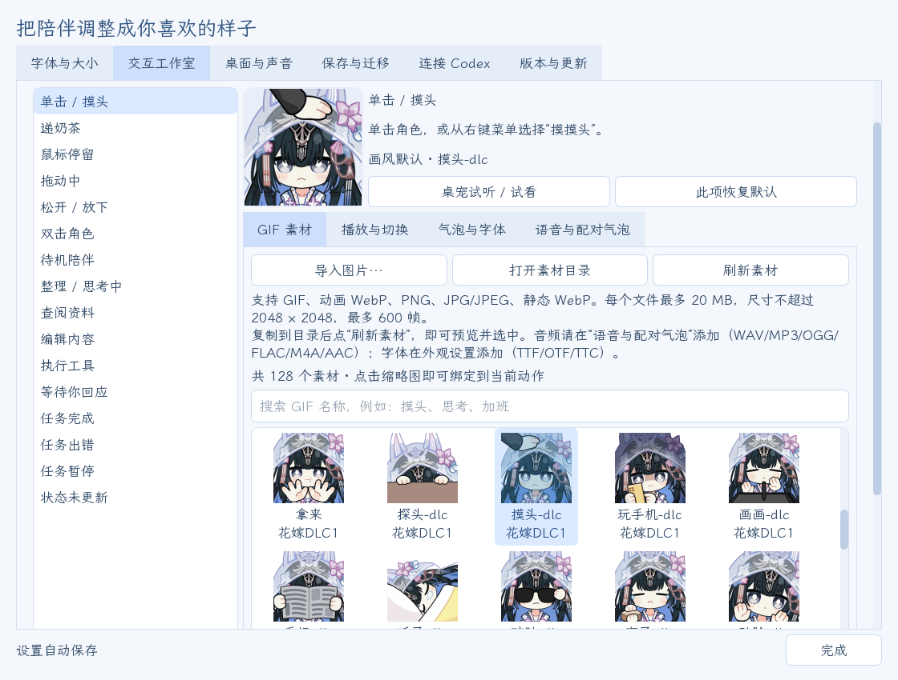
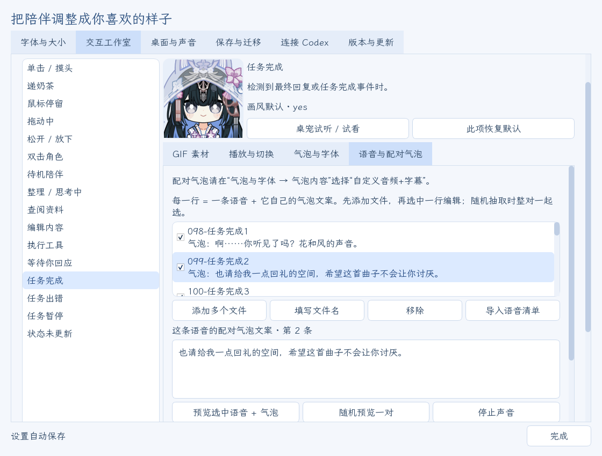
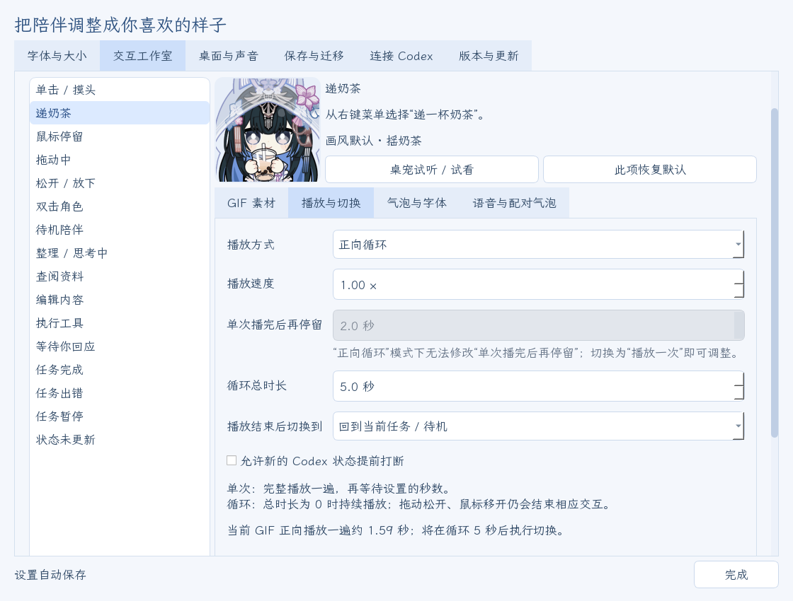
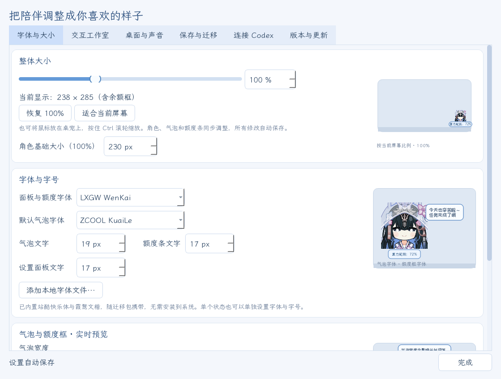
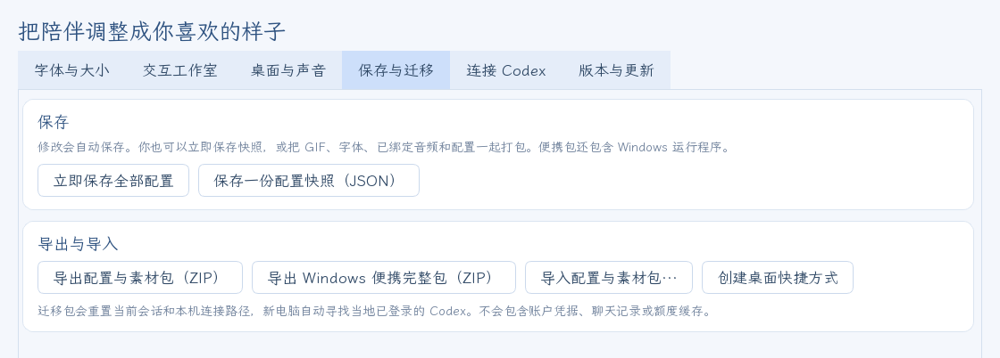

<!-- README language switch -->
[](README.md) [](README.en.md)

**v1.0.5**：去掉了“原皮”表情预设，默认表情固定为花嫁 · 希声时装；原皮等表情仍在表情库里，可在交互工作室给单个交互选用。

**v1.0.4**：休息提醒的“稍后再提醒”可以自己填等多久（1～240 分钟，默认 30），提醒卡片上的按钮按你填的分钟数显示。

**v1.0.3**：补全了 33 条在素材导出时被截短的语音，已安装的桌宠更新后会自动换上完整版本，每句台词的结尾也不再被吞掉一小段。

**v1.0.2 / v1.0.1**：台词一旦开始就会完整说完，说话时点她、拖动她只换动作、不再打断；设置窗口打开即可看到全部预览。

<!-- /README language switch -->

<div align="center">

# 赛琳娜 Codex 桌宠

**《战双帕弥什》赛琳娜陪你使用 Codex：跟随任务切换表情，用她的声音回应你。**

[下载 Windows 版](https://github.com/Doya16/selena-codex-pet/releases/latest) · [使用指南](docs/USAGE.md) · [问题反馈](https://github.com/Doya16/selena-codex-pet/issues) · [English](README.en.md)
<!-- DEMO-LINKS：视频定稿后，在“下载 Windows 版”后面加 [完整演示](<Release 附件 mp4 链接>)；发到 B 站后再加 [B站视频](<链接>)。 -->


[横屏封面](docs/social/cover-landscape.jpg) · [4:3 封面](docs/social/cover-4x3.jpg)

</div>

让赛琳娜陪你使用 **Codex**：任务进行时换表情，完成后用语音和字幕气泡回应，飘字显示这一轮用了多久；桌宠下方显示 Codex 套餐剩余比例或超限配额。

适用于 **Windows 10/11 x64**。完整包附带 **花嫁表情预设、共 128 张的表情库、115 条带字幕的赛琳娜语音** 和两款字体。表情绑定、播放节奏、气泡、语音及外观都已预设，解压后双击「一键部署」即可使用，无需安装 Python。也有 [DeepSeek 版](https://github.com/Doya16/selena-deepseek-pet)，两版可以同时运行，分别保存设置。

## 安装方法

**系统要求**：Windows 10（1809 及以后）或 Windows 11，64 位；Windows 7 / 8 无法运行。建议先在 Windows 上安装并登录 **Codex**（没装也能先运行桌宠，之后再连接）。

1. 打开 [Releases](https://github.com/Doya16/selena-codex-pet/releases/latest)，下载 **Selena-Codex-Windows-v1.0.5.zip**。
2. 解压：右键压缩包 →「全部解压缩」，或用 7-Zip / WinRAR 选「解压到 Selena-Codex-Windows-v…\」（和压缩包同名的文件夹）。
   - 不要选「解压到当前文件夹」：压缩包里没有外层文件夹，文件会散在下载目录里。
   - 不要解压到 `C:\Program Files` 这类不能写入的位置，也不要在压缩软件里直接双击运行。
3. 进入解压出来的文件夹，双击 **一键部署.cmd**。它会：
   - 检查文件是否解压完整、文件夹能否写入；
   - 检查是否已安装 Codex（没装也能先运行）；
   - 创建桌面和开始菜单快捷方式；
   - 启动赛琳娜。
4. 右键桌宠 → **设置**：在 **连接 Codex** 中选择跟随的会话，在 **交互工作室** 中更换表情和语音。

之后从桌面快捷方式启动即可。也可以不运行一键部署，直接双击 **赛琳娜Codex桌宠启动.exe**，首次启动同样会创建桌面快捷方式。请保留同目录的其他文件夹。

**如果被系统或安全软件拦下：**

- 弹出「Windows 已保护你的电脑」时，点「更多信息」→「仍要运行」；弹出「打开文件 - 安全警告」时，点「运行」。程序没有购买商业代码签名，所以 Windows 会这样提示，并不是病毒。
- 360、火绒等安全软件如果拦截，请把这个文件夹加入信任区。全部源码公开在 GitHub：[github.com/Doya16/selena-codex-pet](https://github.com/Doya16/selena-codex-pet)；每个版本的发布页都附有 SHA256SUMS 校验文件，可以核对下载的文件是否完整、未被改动。

以后有新版本，桌宠会自己提示，点 **更新并重启赛琳娜** 即可一键更新，设置和素材都会保留（见下文「一键更新」）。

声音默认开启，音量为 10%。在「设置 → 桌面与声音」中调整或关闭。

## 效果预览

<!-- DEMO-PREVIEW：视频定稿后在这里放


[横屏演示 · 1920×1080](<Release 附件 mp4 链接>)

演示对应 **v1.0.5**，时长 **mm:ss**。客户端窗口和任务为示例；桌宠与设置为实际界面。

| 时间 | 展示内容 |
| --- | --- |
| 00:00 | （按成片章节填写） |
-->

下面都是程序的实际界面，额度为示例数值。

| 顶部小锁：锁定后点击穿透 | 底部套餐额度 |
| --- | --- |
|  |  |

| 任务完成：飘字显示用时 | 喝水久坐提醒 |
| --- | --- |
|  |  |

## 表情

默认使用 **花嫁 · 希声时装** 表情包，16 种交互都有对应的花嫁表情：

| 鼠标互动 | 任务状态 | 其他 |
| --- | --- | --- |
| 单击摸头、双击、鼠标停留、拖动中、松开放下、递奶茶 | 思考、查阅资料、编辑内容、执行工具、等待你回应、任务完成、任务出错、任务暂停 | 待机陪伴、状态未更新 |


表情库里还有原皮、社区包、圣诞和新年系列，加上花嫁一共 **128 张**。在 **设置 → 交互工作室** 里，可以给任意一种交互单独换成其中任意一张，也可以导入自己的图片。

每个表情会保持到它的台词说完：单次播放的 GIF 停在最后一帧，循环的继续循环。

## 语音与字幕

- **115 条赛琳娜语音**，来自岚音、幻奏、希声的机体语音和活动剧情配音，按 16 种交互配好，每条都有字幕；同一动作有多条时随机抽取。
- **台词一旦开始就会说完**：她说话时再点、双击、拖动或递奶茶，动作照常变化，只是不出新声音；动作结束后，这句台词的表情会回来，直到说完。
- **字幕气泡**：角色上方显示台词，默认字体为站酷快乐体；字号、宽度在 **设置 → 字体与大小** 调，也可以直接拖动气泡左右边缘。
- **自动播报频率**：待机语音默认每次进入待机有 20% 的概率出声，两次之间至少隔 300 秒；思考可以设成同一轮任务只说一次。
- **安静陪伴（静音）**：右键勾选后立即停止声音，之后不再播报；取消后恢复原来的音量。
- 每句台词何时开始、何时结束，记录在程序目录的 `voice-log.txt`，反馈“台词没说完”时可以附上。

## 跟随任务

- 任务进行时，表情依次切换为思考、查阅、编辑、执行、等你回应；结束时显示完成、出错或暂停。
- 多个项目同时运行时，各会话的完成提醒排队出现，每条台词说完再轮到下一条。
- 在 **设置 → 连接 Codex → 跟随的会话** 中选择“自动跟随最近活动”（推荐），或固定跟随一个会话。
- 勾选“气泡显示已公开的任务进度”后，任务进行时气泡里会显示进度文字。

## 套餐额度

桌宠下方的配额条按账户数据切换显示：

| 显示 | 含义 |
| --- | --- |
| 算力配额：72% | 套餐窗口内还能用的比例；有多个窗口时显示较低的那个 |
| 超限配额：1,234.56 | 套餐用完后，显示账户返回的 credits 余额 |
| 已达支出上限 | 账户返回了支出限制 |

悬停可看各额度窗口和重置时间；右键 → **刷新额度** 立即重读。数字后带 `*` 表示缓存记录。百分比是 `100% − 已使用百分比`，不是现金或固定提问次数；详见 [使用指南](docs/USAGE.md)。

## 桌面陪伴

- **完成飘字与撒花**：任务完成时，角色旁飘出这一轮的用时，并撒彩色纸屑；样式、位置和撒花都能在 **设置 → 桌面与声音** 调整或关闭。
- **贴边藏起**：把桌宠拖到屏幕左右边缘松手，她先靠边待机，安静一段时间后藏起一半（默认 60 秒，可调 10～600 秒）；有任务、有提醒、鼠标移上去或你离开电脑 5 分钟以上时完整出来。
- **全屏隐藏**：勾选“全屏程序运行时隐藏”后，看视频、玩游戏全屏时自动隐藏，退出全屏后回来（默认关闭）。
- **每日小结**：每天第一次运行时显示上一个使用日的小结，例如完成几轮、出错几次、最长一轮用时；右键“今日小结”随时看今天的。
- **喝水和久坐提醒**：连续用电脑到设定的间隔（默认 60 分钟，可调 15～240），赛琳娜递上一杯奶茶，旁边出现提醒卡片，停留 10 秒。卡片上可以选“N 分钟后再提醒”、“知道了”或“关闭提醒”；N 在 **设置 → 桌面与声音 → 休息提醒 → 稍后再提醒** 里填，1～240 分钟，默认 30。离开电脑 5 分钟以上会重新计时。


## 设置、静音与锁定

右键桌宠或托盘 → **设置…**，在同一个窗口调整 **字体与大小、交互工作室、桌面与声音、保存与迁移、连接 Codex、版本与更新**。打开“字体与大小”“桌面与声音”时，每个板块右侧有一张循环播放的预览卡片，按当前设置演示，不影响真正的桌宠。

- **顶部小锁**：鼠标移到角色身上，顶部居中出现小锁，点击即可锁定或解锁。锁定后点击角色会穿透到下面的窗口，鼠标移入时角色变半透明（透明度可调）；小锁仍可点，任务动画和提醒照常。
- **保持置顶**、**缩放**（Ctrl + 鼠标滚轮）都在这里调整。
- **随 Codex 启动 / 退出**：在 **设置 → 连接 Codex** 分别勾选“随 Codex 启动桌宠”“随 Codex 完全退出而关闭”；Codex 完全退出约 8～10 秒后桌宠关闭。
- **声音与托盘**：Windows 音量合成器显示「赛琳娜 · Codex」，可以单独调音量；托盘提示「赛琳娜 · Codex · 点击唤醒/隐藏」，单击切换显示。托盘和底部栏图标可选“APP 小标”（黑白 GPT 小标，默认）或“纯净图标”。
- 关闭程序：右键 → **关闭赛琳娜**。


## 自定义

右键桌宠 → **设置 → 交互工作室**，先在左侧选一个动作，再为它选表情、播放规则、气泡和语音。

| 想改什么 | 在哪里操作 |
| --- | --- |
| 给某个动作换表情 | 交互工作室 → 左侧动作 → GIF 素材 → 点缩略图 |
| 加入自己的图片 | GIF 素材 → 导入图片；或打开素材目录放入文件，再刷新素材 |
| 循环、速度、播完停留和下一状态 | 交互工作室 → 播放与切换 |
| 一个动作放多条语音，每条单独配字幕 | 交互工作室 → 语音与配对气泡 |
| 气泡只显示所播语音对应的字幕 | 气泡与字体 → 气泡内容 → 自定义音频+字幕 |
| 待机语音的频率 | 待机 → 自动播报频率 |
| 思考在同一轮任务只说一次 | 思考 → 同一轮任务只播一次 |
| 字体、字号、气泡宽度、配额条大小 | 设置 → 字体与大小；或拖动气泡、配额条左右边缘 |
| 完成飘字、撒花、贴边、全屏隐藏、休息提醒、锁定 | 设置 → 桌面与声音 |
| 跟随哪个会话；随 Codex 启动、退出 | 设置 → 连接 Codex |

| 选表情 | 语音与配对字幕 |
| --- | --- |
|  |  |



支持 GIF、动画 WebP、PNG、JPG/JPEG；语音支持 WAV、MP3、OGG、FLAC、M4A、AAC；字体支持 TTF、OTF、TTC。自带 **霞鹜文楷** 和 **站酷快乐体** 两款字体。



## 一键更新

桌宠启动后会在后台检查新版本，默认每 6 小时检查一次（可调 1～168 小时）。发现新版时，桌宠旁出现无声更新气泡；点击 **更新并重启赛琳娜**，即可完成下载、校验、安装和重启。


- 更新只下载程序文件，保留 GIF、语音、字幕、字体和全部个人设置。
- 更新清单由发布者离线密钥签名（Ed25519），签名不对就不会安装；无论经 GitHub 还是镜像下载都会校验。
- 下载中断不会修改现有程序；安装中断或新版启动失败，会恢复更新前的版本和设置。
- **更新来源**可选 **自动选择 / GitHub 官方源 / 镜像加速（中国大陆网络）**。镜像由第三方 [GH-Proxy](https://gh-proxy.com/docs/github-accelerator) 提供，只负责传输。


详见 [更新与恢复](docs/UPDATES.md)。

## 保存与换电脑

设置自动保存。在 **设置 → 保存与迁移** 可以：

- 导出 **配置与素材包**（ZIP）：GIF、图片、全部语音、配对字幕、字体和设置；
- 导出 **Windows 便携完整包**：上面这些再加运行程序，在新电脑解压即可使用；
- 导入别人的或 DeepSeek 版的配置素材包，继续用自己的搭配。

换电脑后在新电脑登录 Codex，启动一次桌宠即可。Codex 的登录信息和聊天记录不在桌宠包里。



## 常见问题

**一键部署提示“在压缩包里直接运行”？** 先把整个 ZIP 解压到一个文件夹，再双击里面的「一键部署.cmd」。

**提示文件夹不能写入？** 不要放在 `C:\Program Files` 这类系统目录，换到自己的文件夹，例如 `D:\赛琳娜Codex桌宠`。

**表情没有跟随新任务？** 在「设置 → 连接 Codex」选择「自动跟随最近活动」。

**没有随 Codex 启动？** 先手动运行一次桌宠，并确认已勾选「随 Codex 启动桌宠」。移动程序目录后，也需要在新目录手动运行一次。

**某句台词好像没说完？** 到 [Issues](https://github.com/Doya16/selena-codex-pet/issues) 反馈时附上程序目录里的 `voice-log.txt`。

**遇到其他问题？** 到 [Issues](https://github.com/Doya16/selena-codex-pet/issues) 附上系统版本、操作步骤和报错截图。

## 素材来源与致谢

表情包素材来源：**赛琳娜厨子 QQ 群 978621218**。感谢赛琳娜厨子们制作并分享这些表情包（原皮、花嫁、DLC、社区包、圣诞与新年系列）。

角色语音来自《战双帕弥什》赛琳娜（岚音、幻奏、希声）的机体语音与活动剧情配音。

角色、表情包图片与原版语音的权利归各自权利人所有（《战双帕弥什》© 库洛游戏）。本项目为同人作品，与官方无关。表情包仅供个人、非商业使用，请勿倒卖或用于付费分发。程序依赖及字体的许可不适用于角色素材；详见 [素材说明](assets/CREDITS.txt) 和 [第三方许可](THIRD_PARTY.txt)。

<details>
<summary>从源码运行</summary>

安装 Python 3.12，在项目目录执行：

```powershell
python -m venv .venv
.\.venv\Scripts\python.exe -m pip install -r requirements.txt
.\.venv\Scripts\python.exe -m selena_pet
```

源码入口：根目录的 **赛琳娜Codex桌宠启动.vbs**，或上述命令。程序模块位于 `selena_pet/`；构建、发布和快捷方式工具位于 `tools/`。

构建便携版：先运行 `.\.venv\Scripts\python.exe -m pip install -r tools/requirements-build.txt`，再运行 `.\.venv\Scripts\python.exe tools/build_portable.py`。输出在 `dist/赛琳娜Codex桌宠/`。发布文件由 `tools/make_release.py` 生成，更新清单用 `tools/sign_update.py --key` 签名。

运行检查：`.\.venv\Scripts\python.exe -m unittest discover -s tests`。

</details>
